# Desktop app UI design

How the Clicky desktop app looks and moves, as built in `apps/desktop/src/renderer/`. The window code is in `apps/desktop/src/main/` (`overlay-manager.ts`, `task-strip.ts`, `allow-orb.ts`, `dashboard-window.ts`). Screenshots are in [`app-ui/`](app-ui/).

The design has one character, the blue triangle. Everything else is quiet chrome around it: a black notch at the top of the screen when Clicky is working on a task, a small red orb when it is allowed to act without asking, and a settings dashboard that follows Windows 11.

## The triangle cursor

Drawn on a full-screen transparent `<canvas>` (`overlay/main.ts`). It is click-through and kept out of Clicky's own screenshots.

**Shape.** An equilateral triangle with softly rounded corners (each corner is rounded by 7% of its size). It has a linear gradient from a lighter tint to the cursor colour, a coloured glow, and a thin white outline. One corner is the tip.

**Colour and size.** The colour is set on the dashboard's Cursor page: blue `#2f8cff` (the default), purple, green, orange or pink. Sizes are small, medium and large (16, 22 and 30 px). The triangle turns amber `#f59e0b` while showing an error, and it drops to 40% opacity when Clicky is paused.

**Parking near the mouse.** While idle it trails the real pointer: past the Windows arrow, then about 1 physical centimetre further down and to the right. The centimetre is measured with the display's pixels per cm. It follows with a soft spring, and its tip turns to face the pointer. While you dictate, it parks just right of the text caret instead, with its tip pointing back at the caret.

**Flying to a target.** When the answer contains `[POINT:x,y:label:screenN]`, the triangle flies along a quadratic arc that bows upward (sideways near the top edge). It eases in and out over 420 to 1100 ms depending on distance, turns along the path, and swells by up to 35% mid-flight. On arrival its tip rests exactly on the target with a gentle 2.5 px hover. A ring pulses out from the point, and a label bubble pops in. The flight out is never interrupted.

**Returning.** It flies back to the mouse when you start a new question, 12 s after arriving, or about 2.5 s after the interaction ends (once it has pointed for at least 3 s). Moving the mouse more than 100 px during the return cuts it short, and it snaps back to following.

**States.**
- *Listening*: seven small bars beside the triangle move with your voice.
- *Transcribing* and *thinking*: the triangle spins, and a bright white light runs around its outline.
- *Speaking*: a slight pulse.

**Presence.** With "Always show Clicky" off, the triangle fades in (150 ms) when you use Clicky and fades out (400 ms) a second after voice, pointing and drawing have all finished.

**Only one cursor, ever.** There is one overlay per display, but only the display that "owns" the companion draws it. The others stay empty, so the triangle never appears twice even when pointing at another screen.

Walkthroughs reuse the same pieces. A `[TARGET]` step gets a solid ring the size of the control, and a `[HOVER]` step gets a dashed ring, each with a slow pulse around it.

## The speech bubble

Also drawn on the canvas, next to the tip or the target. It is a dark rounded box (`rgba(20,22,28,0.9)`, 8 px radius) with white 13 px Segoe UI Variable text. It is at most 320 px wide and wraps to at most five lines. For a pointing label the border is the cursor colour. Errors use a dark red box with a salmon border. The bubble prefers the space below and to the right of its anchor, and flips to stay on screen. It pops in from half size with a small overshoot and a glow that settles (320 ms), then types itself in at about 40 ms a character. The box is sized for the full text from the start so it doesn't jitter. When the model gives no label, it says one of the original's phrases: "right here!", "this one!", "over here!", "here it is!", "found it!". Labels can be turned off on the Cursor page.

## The notch (agent task status)

When Clicky does a task for you, a 600 × 46 px window hangs from the top centre of the screen (`strip/index.html`). The window never takes focus, so the app Clicky is working in stays active. It is pure black like a screen bezel, square at the top and rounded 22 px at the bottom, and it drops in from above as it appears (260 ms).

From left to right it shows:
- a round badge with a small spinning triangle
- the goal in bold, with the current step below it in dimmer text (each new step fades in)
- a "Step N" pill
- an Allow button, shown only when Clicky asks
- the Allow all button
- Pause/Resume and Stop (Esc) buttons

A thin light sweeps along the bottom edge while Clicky works. The accent follows the cursor colour.

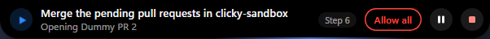

**Asking.** When a step is risky, the accent turns amber. The step line becomes the question, and an amber Allow button appears.

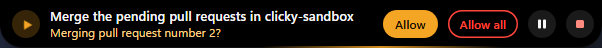

**Allow all.** The Allow all button is a red outline while off. When on, it is solid red with a glow and reads "All allowed".

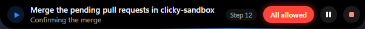

Pausing stops the sweep and the spin. The step line then explains why: you moved the mouse, another agent is using the PC, or you pressed pause.

## The red Allow-all orb

While Allow all is on, a small red orb sits near the right edge of the screen, about 1 cm in and vertically centred (`orb/index.html`). The window lets clicks through everywhere except the orb itself. The orb is 14 px with layered radial gradients. It never settles: its outline wobbles, it breathes (scales to 1.18 with a stronger glow) and the light inside drifts. On hover it stretches into a 224 × 76 dark red card (320 ms, slight overshoot) that says Allow all is on, with a red **Turn off** button. Moving away closes the card after 250 ms.

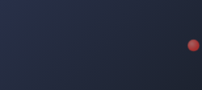

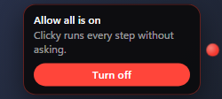

The card text in the current code reads "Clicky acts without asking. That's risky." The screenshot shows earlier wording.

## The dashboard

A normal window (`dashboard/`) styled like Windows 11 Settings. It has a 220 px sidebar, Segoe UI Variable at 14 px, rounded cards with hairline borders, toggles and selects. It follows the system light or dark theme. In light mode the background is `#f3f3f3` with a `#0067c0` accent. In dark mode it is `#202020` with cards `#2b2b2b` and a `#4cc2ff` accent. The sidebar starts with the triangle mark and "Clicky".

Sidebar pages:

- **Today.** A greeting with your first name if you gave one, a Ready card with the hold keys (Right Ctrl to ask, Right Alt to dictate), a box to type a question, stats (answers, last and typical response time from key-up to first word), tasks that run when you step away from the mouse, and recent answers.
- **History.** Searchable questions and answers, kept as text on this PC only. Screenshots and audio are never saved. Clear all.
- **Actions.** Saved actions are questions Clicky can re-ask about whatever is on screen. You can run them from here or from the tray, and save any past question from History in one click.
- **Writes like me.** What Clicky has learned about your writing, optional personal details, dictation settings and a try-it box.
- **Playbooks.** Switchable instruction sets (email replies, pitch help and so on).
- **Helpers.** Named helpers (for example "Pitch Lab"), each with a job, its own notes and its own folder in `Documents\Clicky`. Below them are *Routines* (plain-language recurring jobs that run while you're away from the mouse) and *Connectors* (any MCP server by URL or local command, with keys encrypted by Windows and never shown again).
- **General**, **Cursor** (colour swatches, size, labels, always show, keep out of screenshots), **AI and voice** (provider presets, on-device speech, speed), **API keys** (a badge shows when one is missing or rejected) and **About** (with troubleshooting).

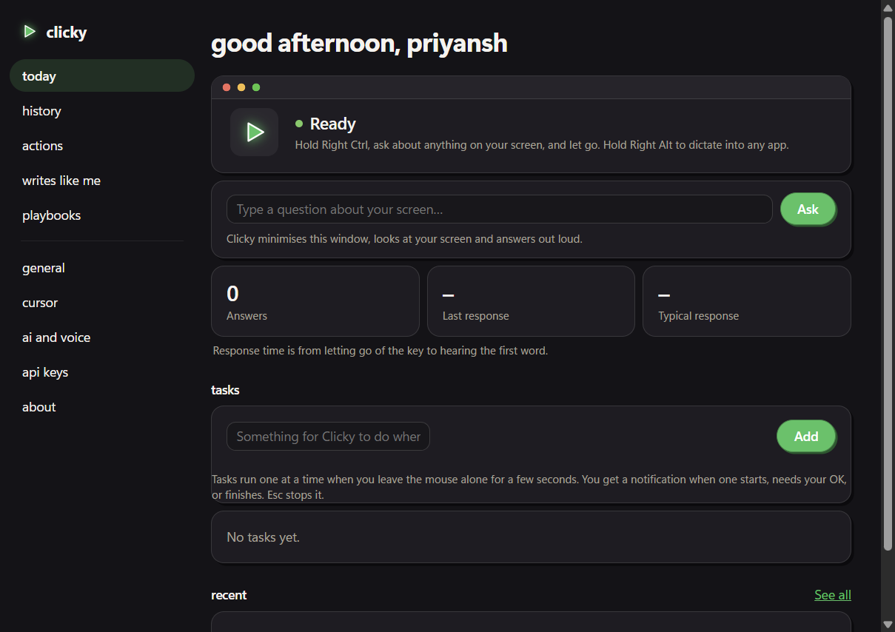

The screenshot is from an earlier build, with a dark theme, a green accent and lowercase navigation. The current code uses the Windows 11 palette above and title-case page names, and it adds the Helpers page.

## Onboarding

**The setup wizard (current).** On first run the dashboard opens a modal wizard with seven steps:

1. *welcome*
2. *providers*: presets, with "Free and offline" recommended. It uses the built-in model and on-device speech, so it needs no key.
3. *keys*: skipped automatically when the chosen preset needs none.
4. *key*: press your hold key, which is detected live.
5. *mic*: pick a device, with a live meter.
6. *about*: what you do, which switches on matching playbooks.
7. *done*: try it for real.

Progress dots sit at the top, and an `aria-live` region reads "Step n of 7". Back, Next and a skip link ("Set up later", "Skip for now", "Skip the rest") sit at the bottom. Focus moves into each new step, and Tab stays inside the wizard. A separate, later wizard ("Let Clicky do tasks for you") switches on agent mode with consent.

**The early setup screens.** These are the first installer concept: warm paper, the rounded triangle, a lowercase wordmark and a big blue pill. The same look survives in the NSIS installer artwork and the app icon (`apps/desktop/scripts/installer-art.cjs`).

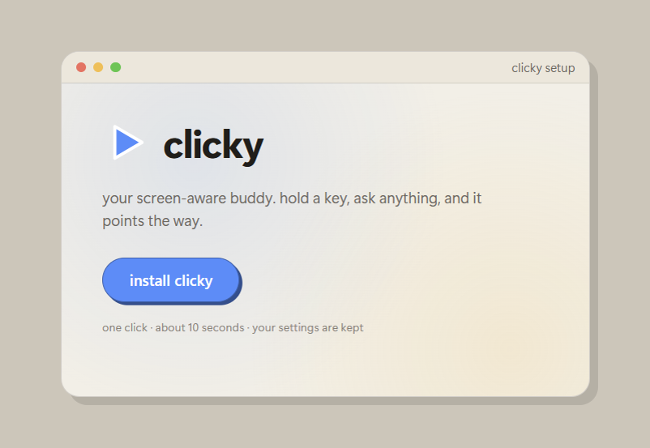

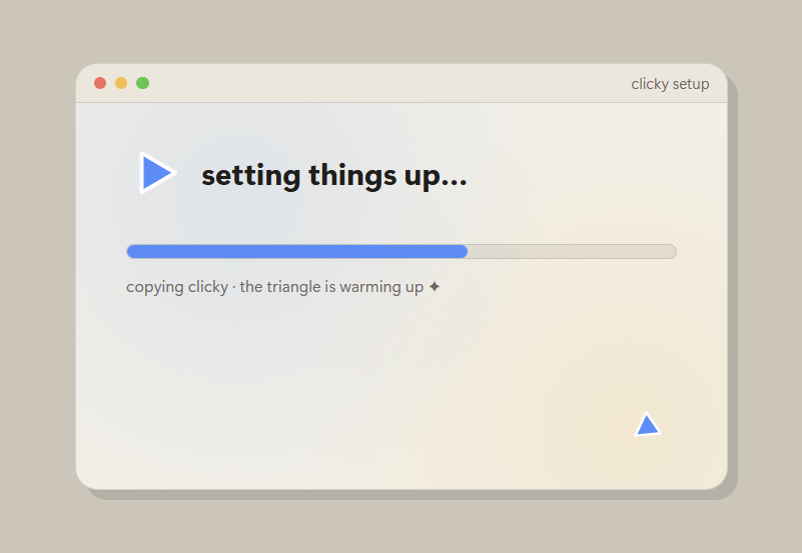

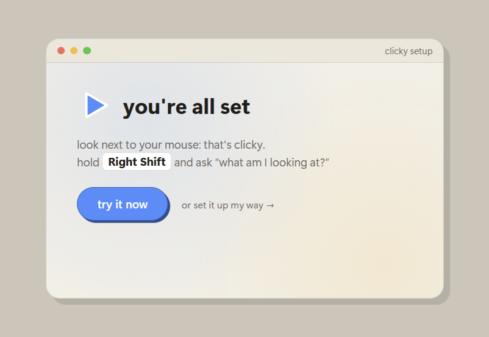

An onboarding review on 2026-10-11 flagged three problems with these screens: macOS traffic-light buttons on a Windows installer, a "you're all set" screen shown before any provider was set up, and a hold key that didn't match the dashboard. The current rules are native Windows 11 chrome, no "all set" from the installer (it hands off with "Opening Clicky…"), and the real keys, mic, overlay and notch in every step.

## Drawing on the screen (parked)

Clicky can also draw on the overlay: arrows, boxes, circles, highlights, freehand paths and handwriting (Ink Free / Segoe Print). An answer can carry up to three marks next to a point. A "draw …" request can produce up to twelve. The triangle acts as the pen. It glides to the start of each mark, holds its tip down-left on the line and draws the marks one after another, at about 1.5 px/ms with a short pause between strokes. Finished marks get a label bubble and fade out after about 20 s. A point that arrives while the pen is busy waits until the drawing is done. The tray's "Show me a drawing" plays a built-in example. Drawing inside an app such as Paint is an agent task that uses a drag action.

As of 2026-10-15 further work on drawing is parked. The code stays in place and works, but it is not being extended.

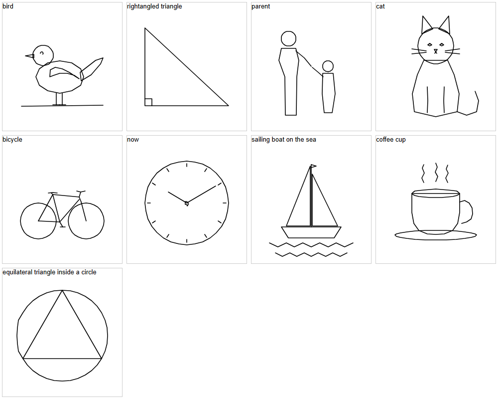

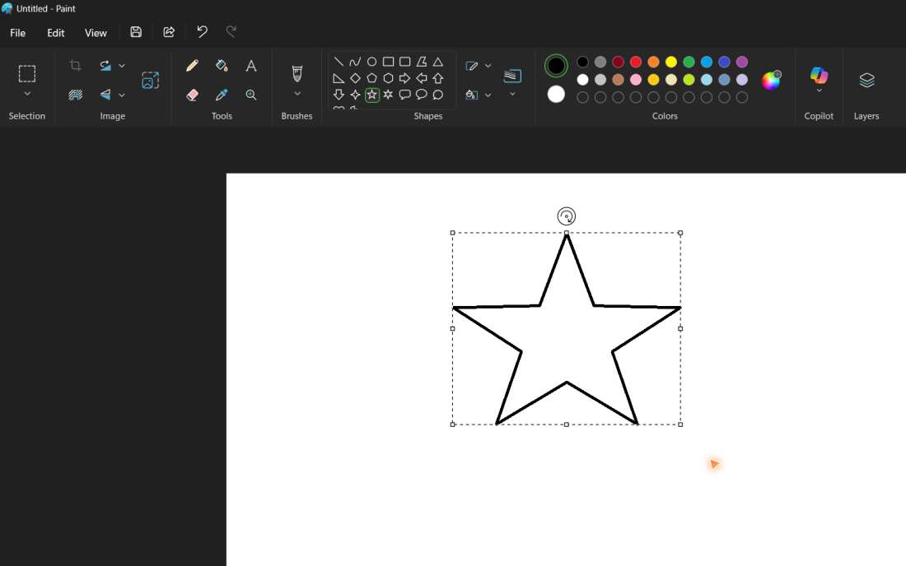
