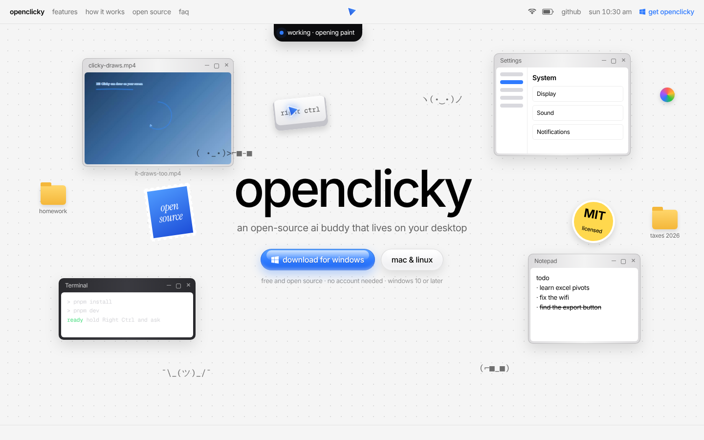
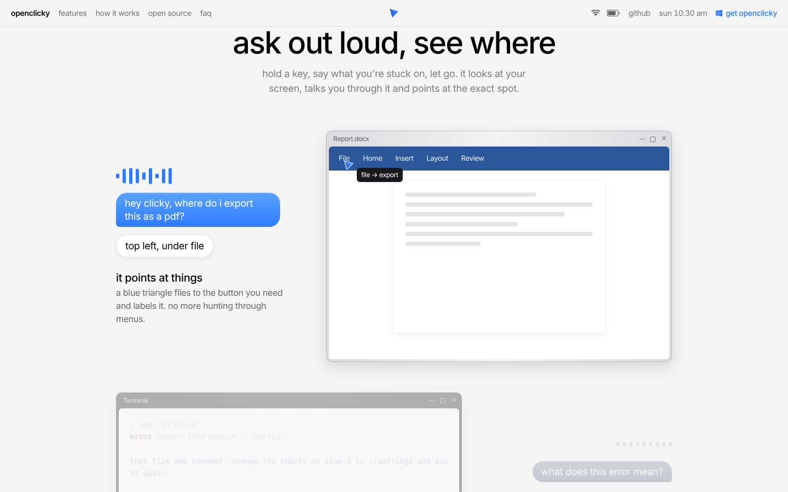
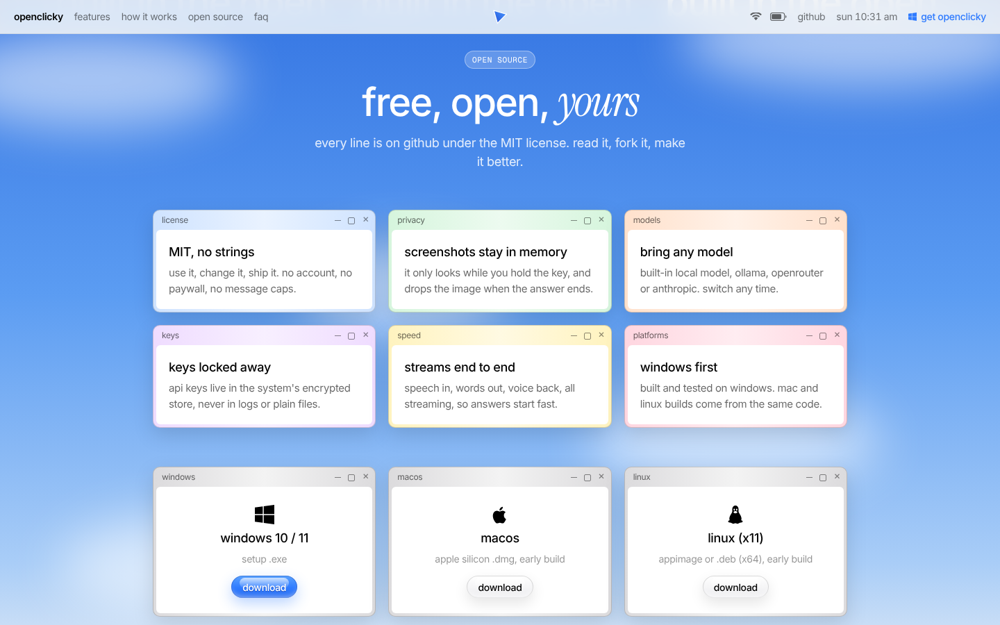
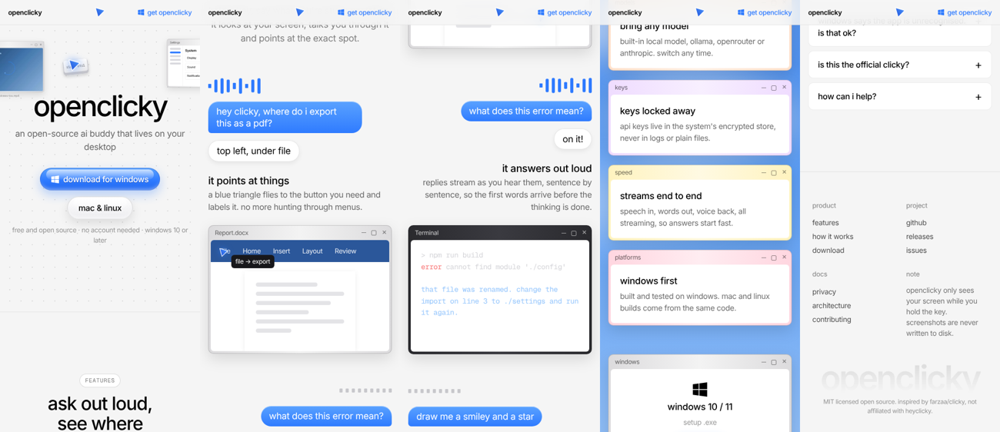

# OpenClicky website design

The project website: a single static page that explains what OpenClicky does, shows it moving, and sends people to the GitHub release. It lives in `apps/website/` (`index.html`, `styles.css`, `main.js`, `assets/`) and arrives with draft PR #29. There is no framework and no build step.

How we studied the official Clicky site, and which of its techniques we reused, is written up in [`docs/website-teardown.md`](../../website-teardown.md). That file also arrives with PR #29.

## Purpose

- Explain the product in one look: hold a key, ask about the screen, hear the answer, watch the blue triangle point at it.
- Send Windows users to the installer (`releases/latest` on GitHub). macOS and Linux get the same link, labelled as early builds.
- Say plainly what makes this version different: MIT licensed, no account, a built-in local model, screenshots kept in memory only.
- Never pretend to be the official Clicky. The FAQ and footer say it is independent and not affiliated with heyclicky.

## Page structure

1. **Menu bar** (sticky header, 48px). It is styled like a desktop menu bar. On the left are the lowercase wordmark and section links (features, how it works, open source, faq). In the centre is the triangle glyph, which tilts on hover. On the right are Wi-Fi and battery icons, a github link, a live lowercase clock (`sun 10:30 am`, updated every 15 s) and a blue "get openclicky" link with the Windows logo. The bar is frosted (backdrop blur over 86% opaque grey).
2. **Hero**: a desktop you can play with. A 1440 × 820 "artboard" sits on a dot-grid background. On it are faux windows (a looping video of Clicky drawing, a Settings window, a Terminal, a Notepad to-do list), a black notch reading "working · opening paint", a tilted "right ctrl" keycap, an MIT sticker, a perforated "open source" postage stamp, folders, kaomoji and a colour-wheel spinner. Windows and stickers can be dragged, and the one you grab comes to the front. In the middle are the `openclicky` wordmark, the line "an open-source ai buddy that lives on your desktop", an aqua "download for windows" pill, a frosted "mac & linux" pill and a fine-print line.
3. **Features: "ask out loud, see where".** Five alternating rows: *it points at things*, *it answers out loud*, *it can draw too*, *dictate into any app*, *runs on your machine*. Each row has a blue waveform, a request pill that types itself, a white reply pill, a title and a short paragraph, and next to them a small window scene built in CSS: a Word-like ribbon where a mini triangle flies to File, a terminal where the answer streams in word by word, the drawing video, a mail draft that fills in, and a model picker.
4. **How it works: "one key, three beats".** Three white cards: *hold* (a keycap), *ask* (animated mic bars) and *let go* (a hopping triangle).
5. **Open source: "free, open, *yours*".** A blue sky band with blurred clouds and a marquee repeating "built in the open". Below it are six promise cards drawn as small tinted windows (license, privacy, models, keys, speed, platforms) and three download cards (Windows 10/11 setup .exe, macOS early build, Linux X11 early build), then a note that builds are unsigned and SmartScreen may warn.
6. **FAQ: "questions, answered".** Nine native `
` rows with a + that turns into ×. The first row starts open.
7. **Footer.** Link columns (product, project, docs), a privacy note, a huge faded `openclicky` wordmark and a one-line disclaimer.

## Visual language

**Colour.** The page background is light grey `#f5f5f5` with black ink, and secondary text is black at 60% and 42%. The one accent is blue: `#2f7bff`, with `#1d4ed8` for depth. The triangle uses a gradient from `#1d4ed8` to `#4f9bff` with a white edge. Dark scenes (Terminal, model picker) use zinc greys, green for "ok" and red for errors. The promise cards each get a soft pastel tint (blue, green, peach, lilac, yellow, pink). The open-source band runs from `#2f6fe0` down to the page grey. The page is light only (`color-scheme: light`).

**Type.** Inter for body and headings, set at medium weight (500) with tight negative letter-spacing. Instrument Serif italic for single accent words (*yours*, the stamp). Geist Mono for chips, keycaps, kaomoji and terminal text. All copy is lowercase. The wordmark is 56 to 104px, and section headings are 36 to 56px (`clamp`).

**Shapes.** Faux windows have a soft grey gradient frame, 10px outer and 6px inner radius, and a `drop-shadow`. They use Windows-style caption buttons (minimise, maximise, close) rather than macOS traffic lights, because the product is Windows first. Buttons are glossy pills: "aqua" (a blue gradient with a white highlight across the top half) and "glass" (white to light grey). Request pills are blue speech bubbles with one squared-off corner. Reply pills are white.

**Motion.**
- Every hero item fades up 10px on load, staggered by `--enter-delay` (0.12 s to 0.46 s).
- Feature rows away from the middle of the screen are dimmed (35% opacity, desaturated). An IntersectionObserver lights the row in the middle band, which starts its waveform, types the request at about 32 ms a character, shows the reply, then streams the answer word by word (70 ms a word), echoing how the app speaks before the whole reply is ready.
- Videos load lazily and play only while on screen.
- The open-source marquee scrolls continuously (28 s loop). Cards lift and tilt slightly on hover.

**The cursor animation.** A glowing blue triangle (the `#tri` symbol, tip up-left like the app's cursor) flies around the hero. It visits a list of stops in turn: the download button ("start here"), the keycap ("hold this key"), the Sound row in Settings ("sound settings"), the drawing video ("yes, it draws"), the MIT sticker ("free, forever") and the Notepad ("found it"). Each flight follows a quadratic curve that bows upward, eased in and out, and lasts 450 to 1100 ms depending on distance, the same arc as the app's pointer. On arrival, a dark label types itself next to the tip, holds for 1.7 s, then the triangle moves on. Stops hidden at the current width are skipped. The loop pauses while the hero is off screen or the tab is hidden. With JavaScript off, the hero is static and nothing breaks.

## Responsive behaviour

- The hero artboard is laid out at a fixed 1440px and scaled with `transform: scale(var(--z))`. `main.js` sets `--z` to `innerWidth / 1440`, with a minimum of 0.45. Drag maths divides by the scale so items follow the finger. All other sections are fluid.
- **Up to 1100px**: the busiest hero items are hidden (Terminal, Notepad, stamp, second folder, spinner, some kaomoji).
- **Up to 860px**: feature rows stack into one column, and promise, download and step grids drop to two columns. The footer drops to two columns.
- **Up to 640px**: the menu bar keeps only the wordmark, the glyph and "get openclicky". More hero items hide, all grids go to one column, and feature rows are always fully lit (no scroll dimming on phones).

## Accessibility

- Semantic structure: `header`, `nav` with `aria-label="Main"`, `main`, and one `section` per area, each with `aria-labelledby` pointing at its heading. There is a single `h1`. Steps are an ordered list, and the FAQ uses native `
`/`
`, so it works with keyboard and screen readers without script.
- Decorative items (the flying companion, status icons, waveforms, sky, marquee, icons) are `aria-hidden`. The centre glyph link has an accessible name.
- Every link and button gets a visible 2px blue `:focus-visible` outline.
- `prefers-reduced-motion: reduce` turns off animations and transitions and smooth scrolling. Videos don't autoplay, and the companion sits still on its first stop with its label shown.
- Feature text is filled in before any animation runs, so nothing is blank if timing or script fails.
- Section anchors have `scroll-margin-top` so the sticky bar never covers a heading.

## Deployment

`.github/workflows/website.yml` publishes `apps/website/` to GitHub Pages as-is. It runs on pushes to `master` that touch `apps/website/**` or the workflow itself, and can also be started by hand. The steps are checkout, `configure-pages`, `upload-pages-artifact` (path `apps/website`) and `deploy-pages`.

**One-time setup:** after PR #29 merges, the owner sets **Settings > Pages > Source = GitHub Actions** in the repository. Without that, the deploy job has nowhere to publish.

## Rules we followed

- **From heyclicky.com we took structure and motion ideas only**: the menu-bar header, the scaled artboard hero, faux windows, scroll-lit feature rows, glossy pills, the marquee, the window-style cards. We never copied their wording, images, video, icons or code. All art, copy and the demo video are our own, and the scenes are drawn in CSS.
- **No testimonials or numbers we can't back up.** We have no testimonials yet, so we show none.
- **No tracking.** There are no analytics, pixels or cookies. The only third-party request is Google Fonts.
- Download links point at GitHub Releases, and every claim on the page (local model, keys in the encrypted store, screenshots kept in memory) matches `docs/privacy.md` and the app's behaviour.
