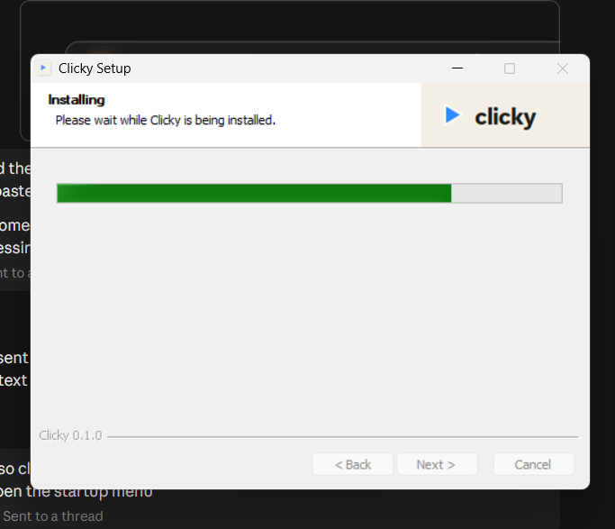
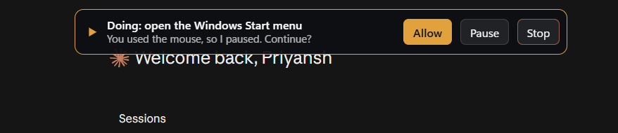
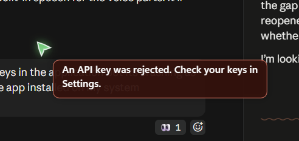
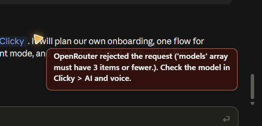
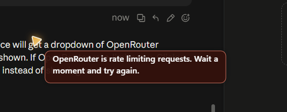
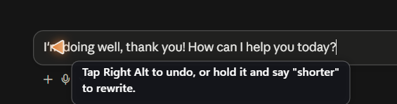
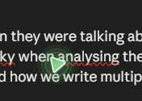
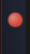

# Owner screenshots

Screenshots the owner shared from the Windows laptop while testing, kept as evidence for bugs and UI decisions. Screenshots that showed personal files, other people or private apps were left out.

| File | What it shows |
|---|---|
|  `installer-progress.png` | The 0.1.0 NSIS installer mid-install. |
|  `notch-paused-after-mouse.png` | The notch pausing an agent task because the user moved the mouse, with Allow, Pause and Stop. |
|  `error-key-rejected.png` | The old generic "An API key was rejected" toast, which didn't name the provider. Errors are now typed by stage and provider. |
|  `error-openrouter-models-limit.png` | OpenRouter rejecting a fallback `models` list longer than 3, which led to the cap of 3. |
|  `error-openrouter-rate-limit.png` | The rate-limit toast. |
|  `dictation-undo-hint.png` | The dictation hint after typing: tap Right Alt to undo, or hold it and say "shorter" to rewrite. |
|  `bug-two-cursors.png` | The bug where two triangles (green and blue) appeared at once, which set the one-cursor rule. |
|  `cursor-over-text.png` | The triangle cursor parked over text. |
|  `allow-all-orb.png` | The red Allow-all orb. |
